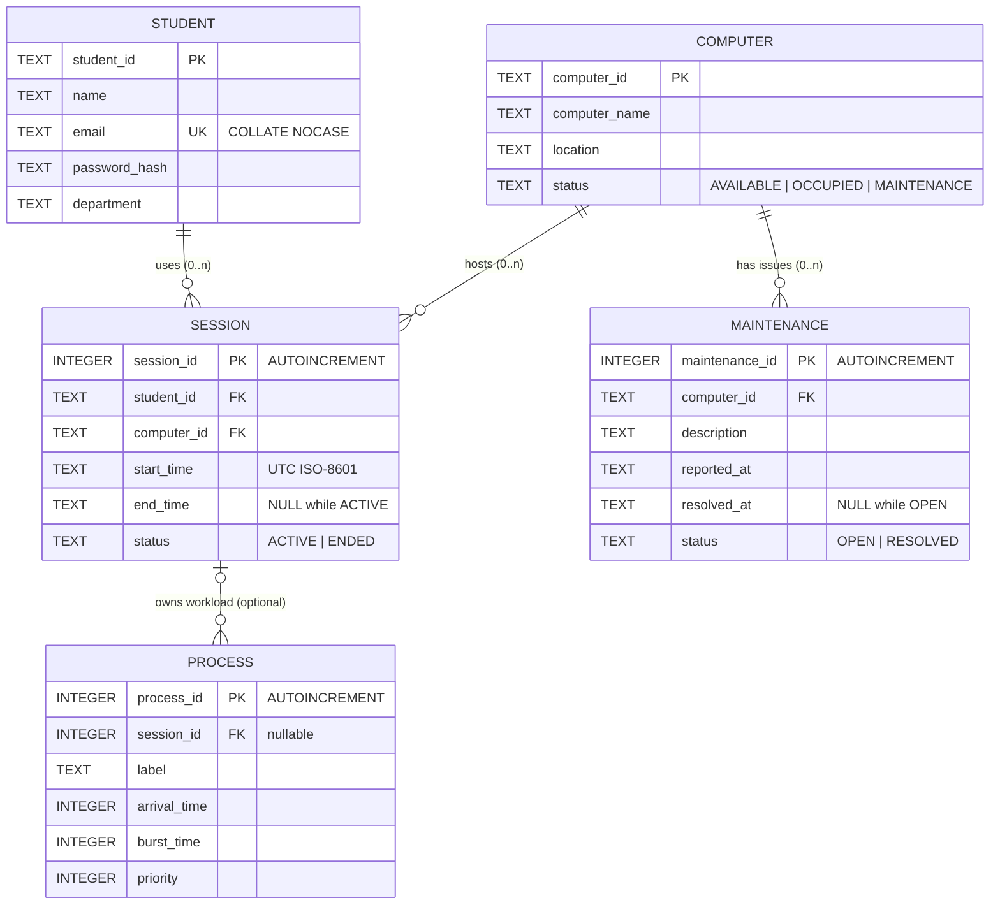

# LabDesk database schema (version 1)

The single source of truth is [`resources/sql/schema.sql`](../resources/sql/schema.sql).
It is embedded in the application and applied on every start: all statements
use `IF NOT EXISTS`, so applying the schema again is a no-op. The version is
stored in `PRAGMA user_version` (currently 1).

## Entity-relationship diagram



The schema is in third normal form. Every non-key attribute depends only on
its table's key: student names live only in `student` and computer locations
only in `computer`, and session queries obtain them through joins.

## Tables

### `student`

| Column | Type | Constraints |
|---|---|---|
| `student_id` | TEXT | **PK**, `NOT NULL`, 2–20 characters, no surrounding spaces |
| `name` | TEXT | `NOT NULL`, not blank |
| `email` | TEXT | `NOT NULL`, **`UNIQUE COLLATE NOCASE`**, must match `%_@_%._%` |
| `password_hash` | TEXT | `NOT NULL`. Format `sha256i$<iterations>$<salt hex>$<hash hex>` |
| `department` | TEXT | `NOT NULL`, not blank |

The brief names this column `password`. It is called `password_hash` because
it never holds the password itself.

### `computer`

| Column | Type | Constraints |
|---|---|---|
| `computer_id` | TEXT | **PK**, `NOT NULL`, 2–20 characters (stored upper-case by the service) |
| `computer_name` | TEXT | `NOT NULL`, not blank |
| `location` | TEXT | `NOT NULL`, not blank |
| `status` | TEXT | `NOT NULL DEFAULT 'AVAILABLE'`, `CHECK IN ('AVAILABLE','OCCUPIED','MAINTENANCE')` |

### `session`

| Column | Type | Constraints |
|---|---|---|
| `session_id` | INTEGER | **PK AUTOINCREMENT** (ids are never reused, which keeps history unambiguous) |
| `student_id` | TEXT | `NOT NULL`, **FK → student** `ON DELETE RESTRICT ON UPDATE RESTRICT` |
| `computer_id` | TEXT | `NOT NULL`, **FK → computer** `ON DELETE RESTRICT ON UPDATE RESTRICT` |
| `start_time` | TEXT | `NOT NULL`, ISO-8601 UTC format enforced with `GLOB` |
| `end_time` | TEXT | NULL or ISO-8601 UTC |
| `status` | TEXT | `CHECK IN ('ACTIVE','ENDED')` |

Table-level checks on `session`:

* `(status = 'ACTIVE' AND end_time IS NULL) OR (status = 'ENDED' AND end_time IS NOT NULL)`
* `end_time IS NULL OR end_time >= start_time`

### `maintenance`

| Column | Type | Constraints |
|---|---|---|
| `maintenance_id` | INTEGER | **PK AUTOINCREMENT** |
| `computer_id` | TEXT | `NOT NULL`, **FK → computer** `ON DELETE RESTRICT` |
| `description` | TEXT | 1–500 characters after trimming |
| `reported_at` | TEXT | `NOT NULL`, ISO-8601 UTC |
| `resolved_at` | TEXT | NULL or ISO-8601 UTC, and `>= reported_at` |
| `status` | TEXT | `CHECK IN ('OPEN','RESOLVED')`, kept consistent with `resolved_at` |

### `process`

| Column | Type | Constraints |
|---|---|---|
| `process_id` | INTEGER | **PK AUTOINCREMENT** |
| `session_id` | INTEGER | NULL (unlinked demo workload) or **FK → session** `ON DELETE SET NULL` |
| `label` | TEXT | 1–16 characters, e.g. `P1` |
| `arrival_time` | INTEGER | `typeof = 'integer'` and `>= 0` |
| `burst_time` | INTEGER | `typeof = 'integer'` and `> 0` |
| `priority` | INTEGER | `typeof = 'integer'` and `BETWEEN 0 AND 99` (lower = higher priority) |

`label` was added beyond the brief's column list so a saved workload keeps the
process names the user typed. `ON DELETE SET NULL` is defensive only: session
rows cannot be deleted (see triggers).

## Indexes

| Index | Purpose |
|---|---|
| `ux_session_one_active_per_computer` — **partial UNIQUE** on `session(computer_id) WHERE status = 'ACTIVE'` | A computer can never have two active sessions. Ended sessions are excluded, so history may repeat a computer |
| `ux_session_one_active_per_student` — **partial UNIQUE** on `session(student_id) WHERE status = 'ACTIVE'` | A student can never have two active sessions |
| `ix_session_student`, `ix_session_computer` | FK lookups, history queries, and the "has history?" check before a delete |
| `ix_computer_status` | Available-computer list and dashboard counts |
| `ix_maintenance_computer (computer_id, status)` | "Open issues for this computer" during resolve |
| `ix_process_session` | Loading a saved workload |

## Triggers

CHECK constraints can only see the row being written, so the cross-table
rules are expressed as triggers. Each one aborts the statement with a readable
message, and the service then rolls back the whole transaction.

| Trigger | Rule |
|---|---|
| `trg_session_active_requires_occupied_computer` | An ACTIVE session can only be inserted after its computer is OCCUPIED. This fixes the allocation order (UPDATE, then INSERT), so a session can never exist without an allocated computer |
| `trg_session_history_is_immutable` | ENDED sessions cannot be updated |
| `trg_session_history_not_deletable` | Session rows cannot be deleted |
| `trg_computer_occupied_only_from_available` | A computer becomes OCCUPIED only from AVAILABLE (never from MAINTENANCE) |
| `trg_computer_no_maintenance_during_session` | A computer cannot become MAINTENANCE while it has an active session |
| `trg_computer_available_requires_clear_state` | A computer cannot become AVAILABLE while it has an active session or an open issue |
| `trg_maintenance_not_on_occupied_computer` | An OPEN issue cannot be recorded on an OCCUPIED computer |
| `trg_maintenance_resolved_is_final` | A RESOLVED issue cannot be reopened |

## Invariants

These follow from the constraints above, and the dashboard checks them on
every refresh (`ComputerService::consistencyProblems`):

1. `computer.status = 'OCCUPIED'` ⇔ exactly one `session` with that computer
   and `status = 'ACTIVE'`.
2. `computer.status = 'MAINTENANCE'` ⇒ at least one OPEN `maintenance` row for
   it.
3. `computer.status = 'AVAILABLE'` ⇒ no active session and no open issue.
4. Each student has at most one active session.
5. Session and maintenance history is append-only.

## Transactional workflows

All workflows use `BEGIN IMMEDIATE`, which acquires SQLite's write lock
before the first read. That means the checks and the updates cannot
interleave with another writer.

**Allocate a computer** (`SessionService::allocateComputer`):

```
BEGIN IMMEDIATE
  SELECT name   FROM student  WHERE student_id = ?                       -- exists?
  SELECT ...    FROM session  WHERE student_id = ? AND status = 'ACTIVE'  -- none?
  SELECT status FROM computer WHERE computer_id = ?                      -- AVAILABLE?
  UPDATE computer SET status = 'OCCUPIED'
         WHERE computer_id = ? AND status = 'AVAILABLE'                  -- expect 1 row
  INSERT INTO session (student_id, computer_id, start_time, status)
         VALUES (?, ?, ?, 'ACTIVE')
COMMIT          -- any failure above: ROLLBACK
```

**End a session** (`SessionService::endSession`):

```
BEGIN IMMEDIATE
  SELECT session_id, computer_id, student_id FROM session
         WHERE student_id = ? AND status = 'ACTIVE'      (or by session_id)
  UPDATE session  SET end_time = ?, status = 'ENDED'
         WHERE session_id = ? AND status = 'ACTIVE'      -- expect 1 row
  UPDATE computer SET status = 'AVAILABLE'
         WHERE computer_id = ? AND status = 'OCCUPIED'   -- expect 1 row
COMMIT          -- any failure above: ROLLBACK
```

**Report an issue**:

```
BEGIN; read status (refuse if OCCUPIED); INSERT maintenance (OPEN);
UPDATE computer to MAINTENANCE if it was AVAILABLE; COMMIT
```

**Resolve an issue**:

```
BEGIN; UPDATE maintenance to RESOLVED; count the remaining OPEN issues
and ACTIVE sessions; UPDATE computer to AVAILABLE only if both are 0; COMMIT
```

**Save a scheduler workload**:

```
BEGIN; DELETE the old rows for that key; INSERT each process; COMMIT
```

An invalid process aborts the whole save, so the old workload survives.

## Timestamps

Times are written by `timeutil::nowUtc()` as `yyyy-MM-ddTHH:mm:ss.zzzZ`
(UTC, millisecond precision). Because the format is fixed-width and always
UTC, ordinary string comparison gives chronological order. That is what lets
the `end_time >= start_time` CHECK work. Times are converted to local time
only for display.

## Foreign-key enforcement

SQLite does **not** enforce foreign keys unless `PRAGMA foreign_keys = ON` is
issued on each connection. `Database::open()` issues the pragma and then
reads it back; if enforcement is not active, the application refuses to start
rather than run without referential integrity.
